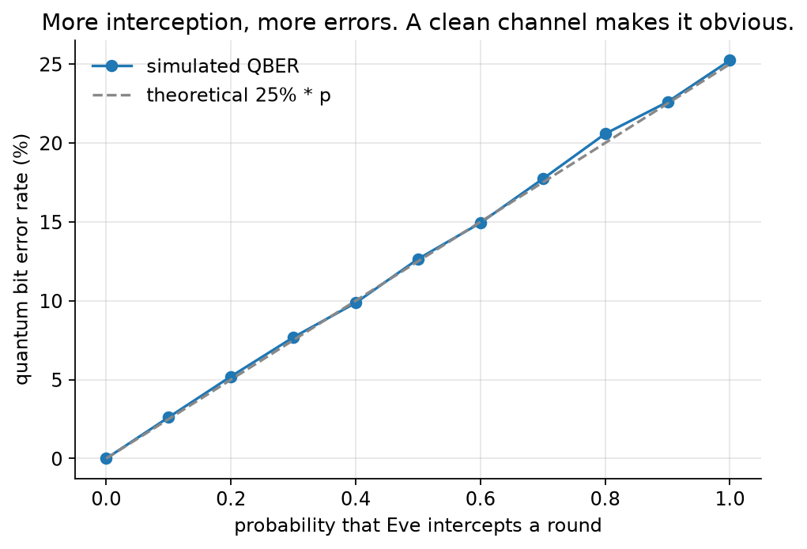
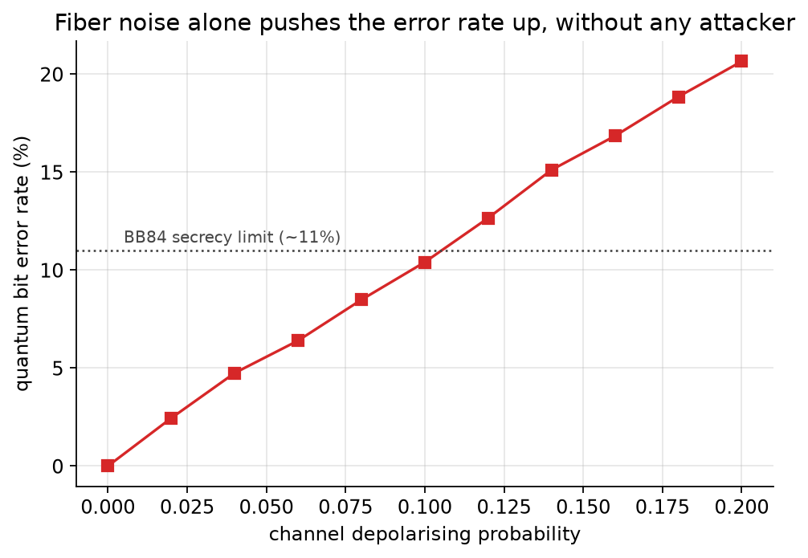
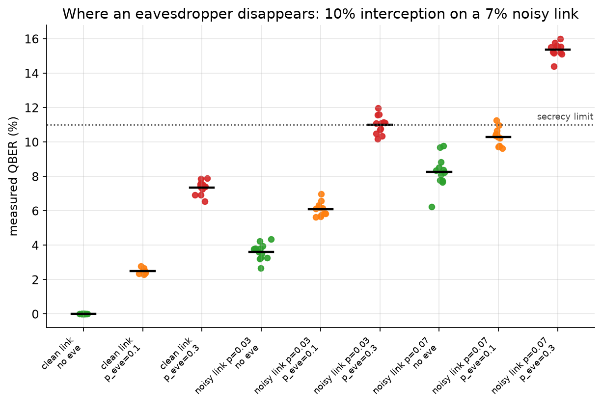
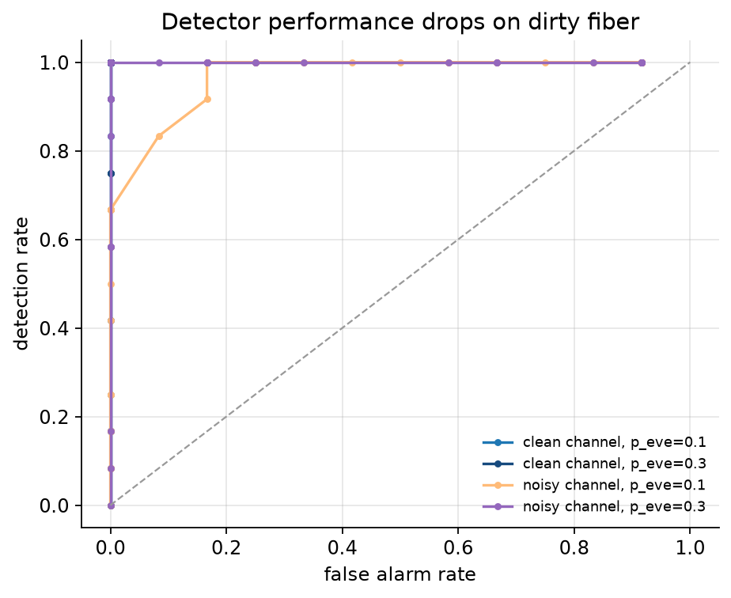
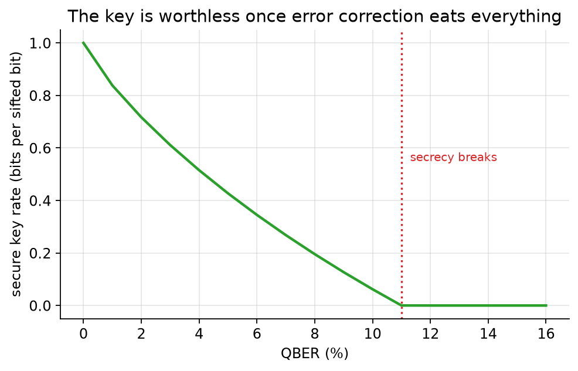

# EveSense

**Qiskit Fall Fest 2026 @ MPSTME — Quantum Secure Communication track**

A simulated BB84 link with an eavesdropper in the middle, and a detector
at each end that has to decide whether the line is being tapped. The
interesting part is not that interception raises the error rate. Everyone
knows that. The interesting part is what happens when the fiber is
already bad.

## The problem

BB84 gets its security from physics. Eve cannot copy a qubit, and she
cannot measure in every basis at once, so any measurement she makes
leaves a trace. Two quantum bits sent through a tapped channel end up
disagreeing about 25% of the time per interception, and the two ends see
that disagreement as a rising quantum bit error rate (QBER).

Deployed fiber is not clean, though. Real links sit around 1-5% QBER
from Raman scattering, detector dark counts, imperfect interferometers.
High-end systems push lower, most of the field does not. So the
receiver is not comparing against zero. It is comparing against a
baseline that already drifts, and it has to answer a question that
looks exactly like a question about weather: did the error rate go up
because someone is listening, or because the line aged?

That question is a detection problem, and detection problems are
measured with hit rates and false alarms. EveSense treats it that way
instead of treating it as a physics demo.

## What this repository does

Four experiments on one simulated link.

1. **Interception sweep.** Eve intercepts with probability from 0 to 1,
   channel is clean. This is the control case, where the protocol
   behaves the way the textbook says.
2. **Channel noise sweep.** Eve stays home, we degrade the channel.
   This produces the baseline she wants to hide in.
3. **Detection study.** Nine conditions mixing clean and noisy links with
   three interception rates, twelve independent runs each. We look at
   the QBER distributions and how much they overlap.
4. **Key rate curve.** What all of the above means for how much secret
   key you actually get out.

## How the simulation works

Each BB84 round is a single qubit. Alice prepares one of |0>, |1>, |+>,
|-> from her bit and her basis choice, Eve does her
intercept-measure-resend if she is active that round, the channel adds
depolarizing and readout noise, and Bob measures in the basis he picked
before the round started.

The rounds are packed into one circuit per batch, one qubit each, so a
batch of 64 rounds costs the same as a single round and the whole study
runs in under a minute on a laptop. Aer's stabilizer method handles it,
which is fair here: everything in the circuit is Clifford.

Eve's measurement outcome is sampled from the Born rule and the state
she resends is re-prepared to match. That is what a mid-circuit
measure-and-resend does, and it keeps the batch structure intact.

```
src/evesense.py   protocol, noise model, experiments
src/plots.py      figures
results/          csv data and png figures
```

## Results

Interception on a clean link behaves as theory predicts. Every 0.1 of
interception probability buys about 2.5 points of QBER, and the curve
sits on top of the 25% * p prediction:



Channel noise alone, with no attacker, moves the same metric by the
same order of magnitude. A 7% depolarizing channel produces about 7%
QBER without anyone listening:



Put the two side by side and the problem is visible. On a 7% noisy link
with nobody listening we measure 8.3% QBER, give or take 0.9. With the
same link tapped at 10% interception probability we measure 10.3%, give
or take 0.5. The two distributions touch, and the receiver has one
number to work with:



The ROC curves make the cost concrete. On clean fiber the detector
separates tapped from untapped at almost any threshold you like. On
dirty fiber the curve collapses toward the diagonal at low interception
probability, which is where a patient attacker works:



The key rate side of it: past roughly 11% QBER, error correction eats
more than half the sifted bits and privacy amplification takes the
rest. The link is still up, it just stops producing key:



## What we found

The numbers point at a tradeoff rather than a solution. A receiver that
wants to catch a quiet attacker needs a low false alarm rate, so it
needs a high threshold, so it misses attacks that stay under the noise
floor. Dropping the threshold catches the quiet attacker and also
starts flagging sunny days. On a 7% noisy link, a 10% interception rate
is not reliably distinguishable from the channel with the sample sizes
we used.

This is the reason QKD deployments spend their money on making the link
clean rather than on making the detector smarter. The security proof
gives you a bound against an attacker, not against the weather.

## Running it

```
python -m venv .venv && source .venv/bin/activate
pip install -r requirements.txt
cd src && python evesense.py
```

Takes about 40 seconds. Results land in `results/`. Seeds are fixed, so
the figures come out the same every time.

## Limitations

- Eve is a textbook intercept-resend attacker. Photon-number-splitting
  and coherent attacks are not modeled, and the security analysis here
  is not a proof.
- The channel is depolarizing plus symmetric readout noise. Real fiber
  has polarization drift and wavelength-dependent loss.
- The detector is a single threshold on QBER. Real receivers run error
  estimation on a disclosed subset and adapt.
- Mid-circuit measurement is emulated by sampling the Born rule rather
  than executed inside the circuit.

## Author

Chiara De Venuto

---

*This document was developed with the assistance of generative AI tools for research, structuring, and content generation. Final content has been reviewed and validated by the author. Full compliance with: Reg. (EU) 2024/1689 (AI Act) Art. 50 · Italian Law 132/2025 Art. 13 · EU Code of Practice on AI Transparency (2026) · U.S. AI Labeling Act (S. 4915) · U.S. H.R.8479 · U.S. Executive Order on AI (Dec 2025) · California TFAIA & AB 2013 (eff. Jan 2026).*
